# Dungeon Divers Solver

The main purpose of this app is to use it as a helper app or map solver for the game called Dungeon Divers. The overall aim of the game itself is to solve each provided map by finding specified secret rooms that are placed on the map, but aren't visible to the player until marked correctly. This app is meant to simulate the map from the game with the option to build your own map structure, define how many secret rooms of each type should be placed on the map and then either display hints for where the secret rooms could be placed or suggest solution on where they are most likely to be located.

This is a rather small app that I decided to make inside Godot 4.x, in order to learn how to use it and become more familiar with it.

## Table of Contents

- [Preview](#preview)
- [Usage](#usage)
  - [Running the Application](#running-the-application)
  - [Basic Controls](#basic-controls)
  - [Map Editor](#map-editor)
  - [Map Controls](#map-controls)
  - [Map Parameters](#map-parameters)
  - [Map Solver](#map-solver)
  - [Save Manager](#save-manager)
- [Known Limitations and Observations](#known-limitations-and-observations)
- [TODOs](#todos)
- [Third-Party Resources](#third-party-resources)
- [License](#license)

## Preview

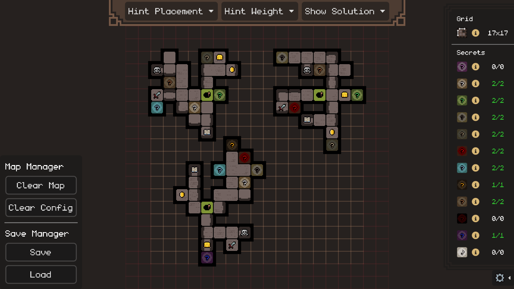

---

## Usage

### Running the Application

#### Web

#TODO

#### Windows/Linux

#TODO

#### Import through Godot Engine

1. Install [Godot Engine](https://godotengine.org/).
2. Clone or download this repository.
3. Import `project.godot` into Godot.
4. Run the project.

### Basic Controls

| Action | Input |
| --- | --- |
| Move camera | Right Mouse Button |
| Zoom | Mouse Wheel Up/Down Scroll |
| Center camera | Mouse Wheel Click |
| Interact / Create room / Open room editor menu | Left Mouse Button |
| Toggle fullscreen/windowed mode | Alt+Enter |

### Map Editor

The main application view contains an interactive square grid used to recreate dungeon maps from the Dungeon Divers game. Its size is defined through map parameters which are editable through the map parameters hud element that is located on the right side of the application.

Each grid cell can be interacted with using the Left Mouse Button, whose effect varies based on the cell state:
- **Empty grid cell** - Creates a new empty room at the selected position.
- **Existing room** - Opens a radial editor menu that allows modifying the room's properties or deleting it.

The radial editor provides access to the available room parameters, allowing the map to be adjusted to match the current dungeon layout. These parameters contain options like:
- **Room Barricades** - Defines which sides of the room should have barricades set up. This option is used by map solver to determine where each secret room type could be placed. Most of them can't be placed next to a room that has a barricade set up on the connecting edge, apart from the Barricade secret room type that requires them to be placed.
- **Specials Setup** - Used to assign a special type to the room. These special types include rooms like Arena, Boss, Entrance, Library, Treasure and Shop. Special types are used by map solver to determine where some secret room types can be placed, which can have restrictions on their placement or can influence the calculated weights for them.
- **Secrets Setup** - Used to assign a secret type to the room. These secret types include rooms like Portal, Common, Guest, Hermit, Boulder, Devil, Angel, Black Market, Barricade, Red, Outsider and Error. Each type has its own set of rules that apply to them, but they apply to the MapSolver and don't have any effect when placing them through room editor.
- **Room Connections** - Defines which sides of the room (including diagonal directions) should have room connections set up. These, similar to how they are set up in the game itself, are only used for visual display of the map and don't affect other aspects of the app. By setting up connections in neighbouring room cells on their connecting sides, it allows to make them look like a one large connected room.

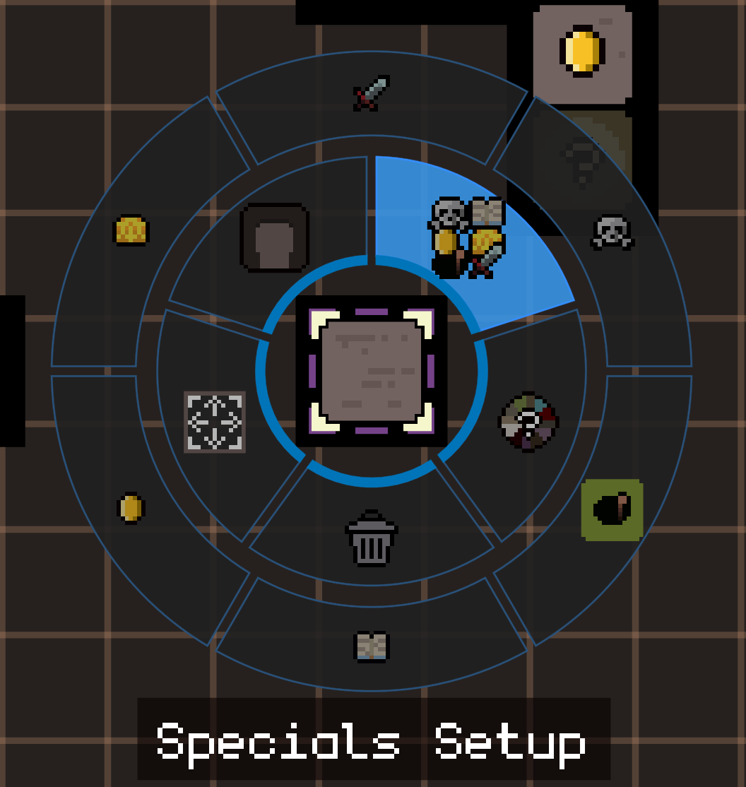

### Map Controls

The controls on the left side of the application provide quick access to map management actions. These actions contain options like:
- **Map Manager** - **Clear Map** - Removes all existing rooms from the current map.
- **Map Manager** - **Clear Config** - Resets the state of all map parameters.
- **Save Manager** - **Save** - Opens the save manager in save mode in order to save current game state through save manager.
- **Save Manager** - **Load** - Opens the save manager in load mode in order to load current game state through save manager.

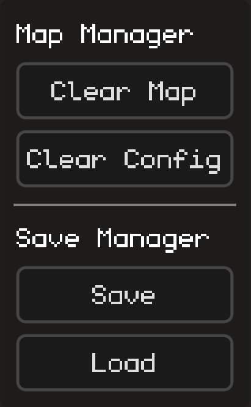

### Map Parameters

The drawer on the right side of the application contains the parameters used to configure the current map and its expected secret room counts. By default the drawer is set in a closed state, in which only the parameter icons and values are visible. The drawer can be opened by clicking on the button under it, which expands it and displays additional details regarding the parameters, including their names and controls for adjusting their values.

These parameters contain options like:
- **Map Grid Size** - Adjusts the dimensions of the map grid. Displays the current map size in the format of NxN where N is current grid size value (by default the map size is set to 17x17).
- **Secret Room Counts** - Defines the expected number of secret rooms for each available secret room type, which are used by map solver to determine how many secret rooms of each type are expected. Displays the secret room count in the format of X/Y, where Y is the set expected number of secret rooms of a given type and X is the current detected count of these secret rooms on the map.

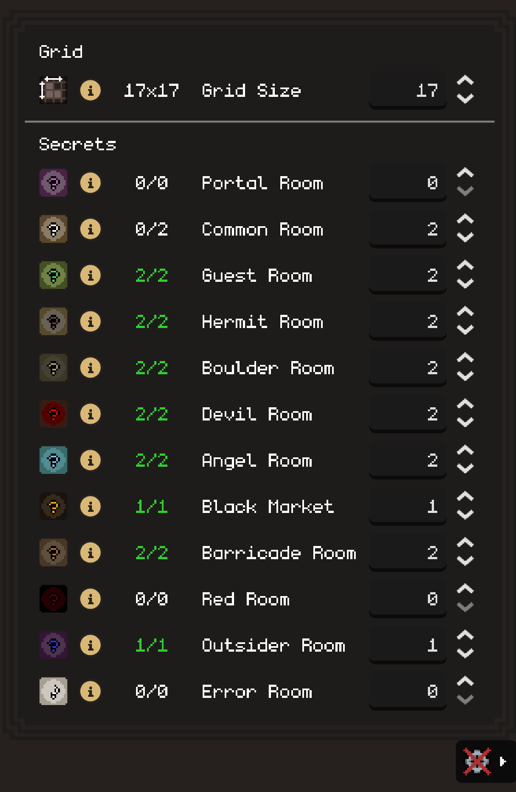

Additional information about each parameter can be displayed by hovering over its corresponding row. This information includes either the short description in case of the map grid size parameter, or description of rules, restrictions and hints of the preferred placement in case of the secret room counts. 

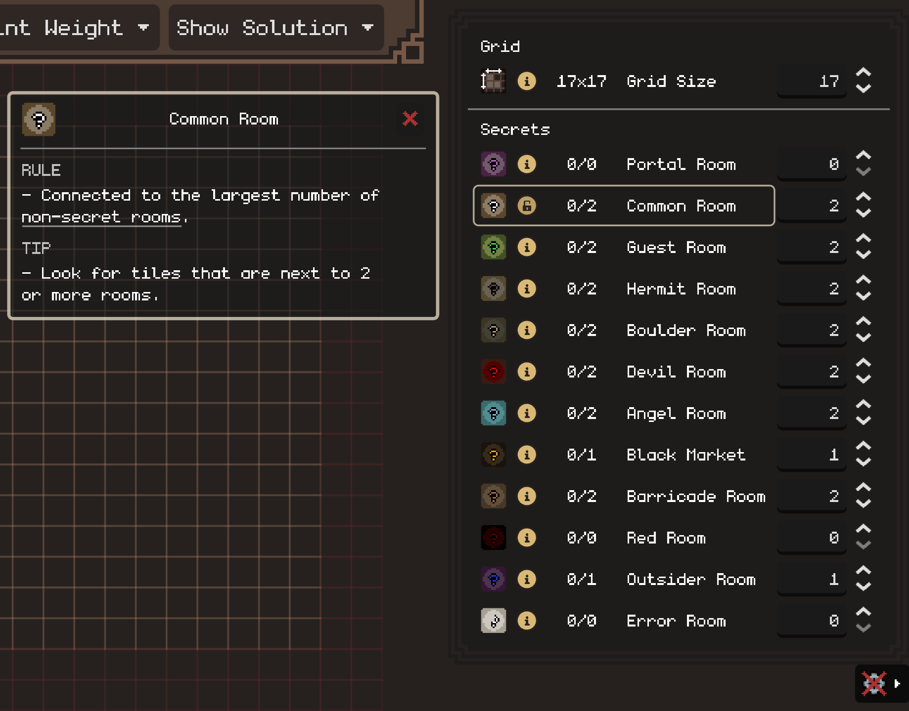

### Map Solver

The map solver is the main feature of the application. It analyzes the current map structure and the configured secret room counts to determine possible placements for them.

The controls on the top side of the application provide quick access to controlling and setting different states to the map solver. Depending on the selected map solver mode, the solver can provide hints about possible secret room placements or provide them with calculated weights which affect where it would be placed or display only placements that are most likely to contain the secret room based on the calculated weights.

There are three types of map solver modes that can be set for each secret room type:
- **Hint Placement** - Shows possible placements on the map for the selected secret room type.
	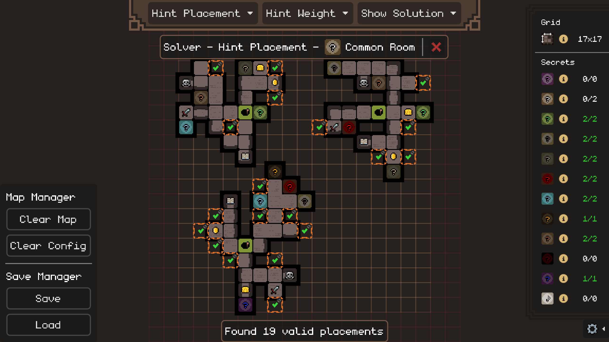

- **Hint Weight** - Shows possible placements on the map for the selected secret room type and calculates each placement weight based on the secret room type. These weights are then color-coded where it assigns each weight a color from a range between green color (for the best calculated weights) and red color (for the worst calculated weights) and they are shown on the map along with the placement.
	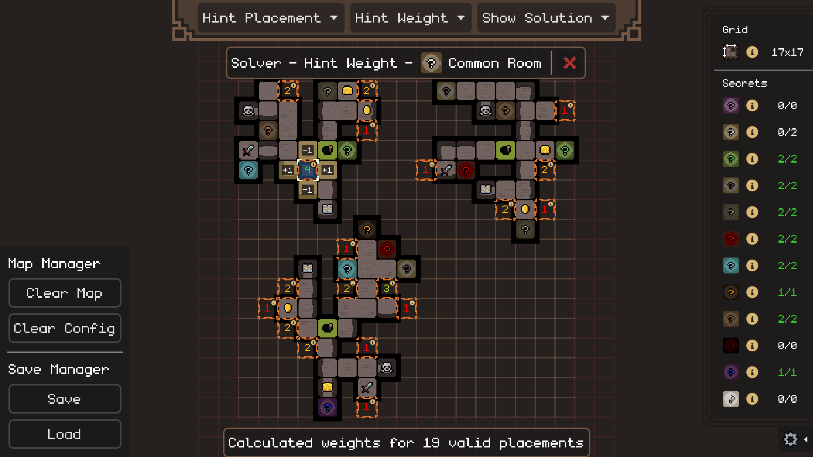

- **Show Solution** - Shows filtered possible placements that are the most likely placements taking into account the validated placements, their weights and how they would affect each other. Instead of numerical weights, it will show the percentage value that determines the probability of the placement containing the secret room based on the calculated weights. If there were two possible placements with the same weights and map solver would only search for one secret room, it would assign both of them 50% values, since they would be just as likely to contain the secret room.
	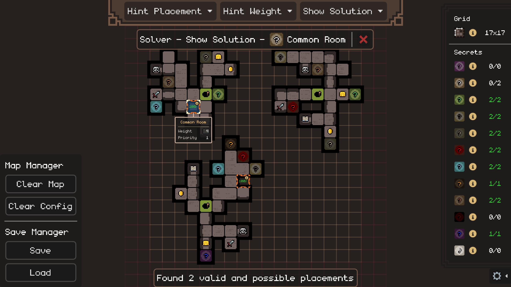

The displayed placement on the map from the map solver also may contain some additional details that can be displayed upon hovering over the displayed placement result. Whether there is some additional information to be displayed or not is dependent on the secret room type that is currently selected and the mode selected in map solver, since it's directly related to the restrictions and rules applied to each secret room type. If the displayed placement has any details that might be displayed upon hover, it will have a yellowish info icon in its top-right corner.

#### Interacting with Map Solver Results

Map Solver results are displayed directly on the map, highlighting the corresponding positions on the map grid. Clicking a displayed placement result creates a secret room of the selected type at that grid position, instead of creating a regular empty room.

### Save Manager

The save manager allows saving, loading, exporting and importing map states.

It can be opened through map controls, which causes it to open either in the save or load modes.
- **Save mode** - Allows users to create a new save, overwrite an existing one or delete an existing save.
- **Load mode** - Allows users to load or delete an existing save. It also provides access to the example saves included with the application.

Saves can be displayed in two modes:
- **Slots View** - Each save is assigned a slot number when it's saved. Slots view allows user to manage and set their saves on different slots to make them easier to manage thanks to the built-in pagination support.
	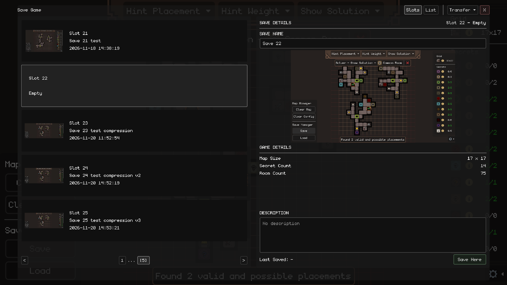
- **List View** - Default mode at which saves are listed and sorted according to the selected sort method (by default it automatically sorts the saves so that the last saved saves would appear first on the list).
	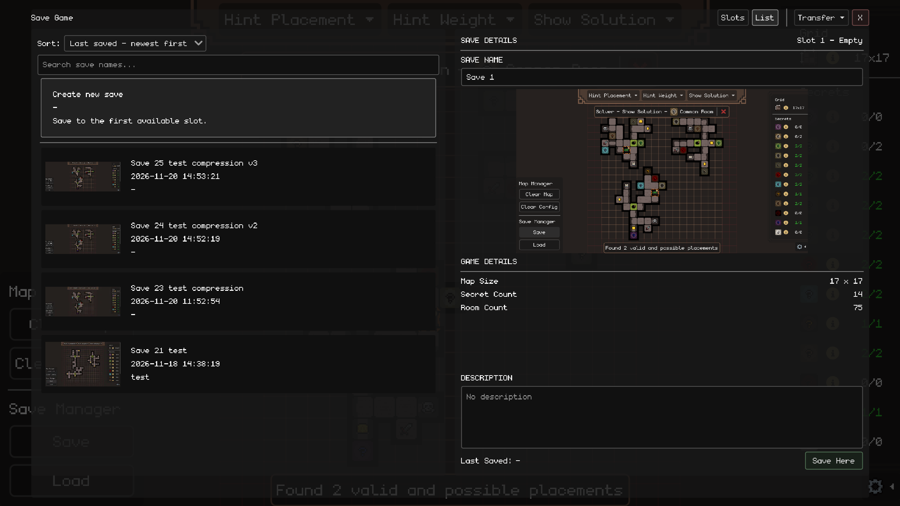

The example saves tab is available through the "Examples" button located at the top right corner of the save manager. Their aim is to showcase different kinds of scenarios and maps that should cover all existing secret room types and some of their edge cases. Users cannot overwrite or delete those example saves directly.
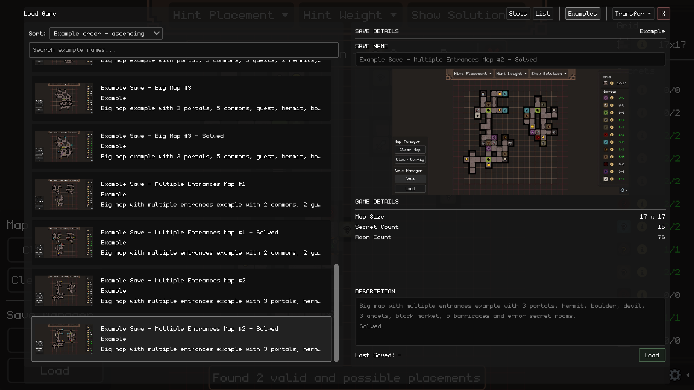

Regardless of the save manager mode, it also offers the option to export an existing save or import the exported save. The main aim of this feature is to be able to easily export and import saves between different builds of the application or to just simply backup the saves. Those transfer options are accessible from the top right corner of the save manager window.
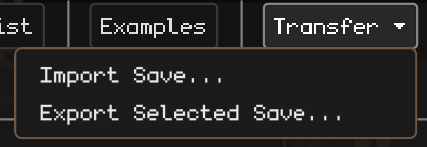 

Exporting save causes it to be packed into a ".ddsave" format and asks user to select where he would like to save the exported file. Importing features an additional modal dialog to be displayed, in which user can select what ".ddsave" file he would like to import and to what slot it should be imported. By default it will have option enabled to select the first empty slot, but the user can also manually select at exactly which save slot number he would like to import the save.
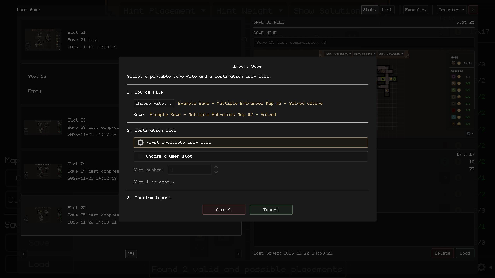

---

## Known Limitations and Observations

**NOTE:** There are some discrepancies between what the game tells the player and what it actually does when preparing different map layouts to solve. Some of these things:

### Secret Room Placement Order and 50/50 Situations

According to the developer, the game isn't supposed to have any 50/50 situations that aren't deterministically solvable and the game is supposed to be selecting secret room placements in the order from the top to bottom to how it lists secret rooms on the side (which is the same order that we use for displaying these secret room types in the map parameters controls). This isn't entirely true, since there are multiple cases where it clearly doesn't follow these rules. It might be true that the secret rooms are placed according to the specified order, but it seems like there is some flaw when it checks if the 50/50 cases would happen or it checks them only after it would finish placing all the secret rooms. To be more precise, there are some cases when even after going in the specified order of placing those secret rooms, there would be multiple 50/50 situations. Usually these 50/50 situations solve themselves, since the potential spots are often overshadowed or taken by some other secret rooms, but it doesn't seem to solve all the possible situations.

### Outsider Room Weight Calculation and Showing Solutions

There might be some issues with map solver set in the show solutions mode for the outsider secret room type when searching for more than one secret room. By default it should be taking into account distances from other secret rooms (excluding error rooms) for its weight calculation, but it isn't clear if it also takes into account other instances of outsider rooms. I wasn't able to verify it through in-game examples, so it might be possible that it might not correctly show solutions for them if there are multiple outsider rooms to be placed, so in these cases it's recommended to place them based on the calculated weights and proposed priority of the solution (both of which are included in the additional details displayed upon hovering over the proposed placement on the map in the map solver show solutions mode).

### Portal Secret Room Placement Discrepancy

During testing I have noticed some weird discrepancy in the game itself when it comes to how it places portal secret rooms. I encountered it only once in-game itself, so it might not be a common issue, but it's worth noting. I have recorded this case in the save examples in the save called "Example Save - Multiple Entrances Map #2 - Solved". The issue is that the placed portal secret room isn't placed according to the rules that are specified by the game itself, since there isn't a clear path that could go out and come back to this portal room without breaking the existing rules. These kinds of situations aren't currently taken into account in the map solver, since I wasn't able to track why it was allowed in the first place, so it might cause some issues in some specific cases like the one presented in the example that I mentioned.

### Error Secret Room Placement Limitations

Calculating weight and showing solutions for the error secret room isn't currently supported. Only hinting valid placement is supported. Error rooms by default aren't placed in a single room, but rather they are moving and changing their positions in a specified looped order after each player move. This makes it impossible to determine its specific placement based on the regular map grid. It's also worth noting that each possible position can be used as the possible placement of the error room, but not all of them have to be part of the looped order of placements. Each placement in the loop can also affect other secret room placements, which may additionally affect the placement specified by the map solver results returned by the application. 

---

## TODOs

Things that could be improved in the future versions:

- [ ] Implement way to load a map state from the game screenshot.
- [ ] Implement audio system for game/map interactions (for example placing a room or destroying it, clicking map/hud elements).
- [ ] Implement map validation based on some basic rules.
- [ ] Implement animations for placing/deleting rooms on map (especially upon loading/importing game state from save).

---

## Third-Party Resources

This project uses and draws inspiration from the following third-party projects, addons, assets, and fonts.

### Inspiration

#### Dungeon Divers

This project is heavily inspired by **Dungeon Divers**, particularly its dungeon-based puzzle mechanics, room presentation, and visual style.

Some visuals are original assets inspired by the visual style of **Dungeon Divers**, while certain room and room-type representations were recreated from the game itself as a visual reference. These assets were drawn independently by me; no original game asset files were extracted or redistributed.

- Developer: Wilson The Ball
- Publisher: GIGATANK 3000
- Source: [Dungeon Divers on Steam](https://store.steampowered.com/app/1844790/Dungeon_Divers/)

### Godot Addons

#### Godot Radial Menu Control

A radial menu `Control` for Godot, used as the basis for the project's radial context menus.

- Author: [jesuisse](https://github.com/jesuisse)
- Source: [godot-radial-menu-control](https://github.com/jesuisse/godot-radial-menu-control)
- License: MIT

#### Easy Store

EasyStore is a lightweight, modular save system addon for Godot 4. It's used as a basis for the project's save manager menus.

- Author: [IUXGames](https://github.com/IUXGames)
- Source: [EasyStore](https://github.com/IUXGames/EasyStore)
- License: MIT

### UI Assets

#### Fantasy UI Borders

Fantasy-themed UI border assets used for parts of the project's user interface.

- Author: [Kenney](https://kenney.nl/)
- Source: [Fantasy UI Borders](https://kenney.nl/assets/fantasy-ui-borders)
- License: [Creative Commons CC0](https://creativecommons.org/publicdomain/zero/1.0/)

#### Game Icons

Game Icons assets used for parts of the project's user interface.

- Author: [Kenney](https://kenney.nl/)
- Source: [Game Icons](https://kenney.nl/assets/game-icons)
- License: [Creative Commons CC0](https://creativecommons.org/publicdomain/zero/1.0/)

### Fonts

#### Monogram

- Author: [datagoblin](https://datagoblin.itch.io/)
- Source: [Monogram](https://datagoblin.itch.io/monogram)
- License: [Creative Commons CC0](https://creativecommons.org/publicdomain/zero/1.0/)

---

## License

The source code and original project documentation are licensed under the [MIT License](LICENSE), unless otherwise noted.

Original artwork and visual assets created specifically for this project are licensed under the [Creative Commons Attribution 4.0 International License](https://creativecommons.org/licenses/by/4.0/), unless otherwise noted.

### Dungeon Divers-Based Visual Assets

Certain room, room-type, special-room, secret-room, and related visual assets were recreated using screenshots from **Dungeon Divers** as visual references.

These assets are explicitly **excluded** from both the MIT License and the Creative Commons Attribution 4.0 license used by this project. No separate license to reuse or redistribute these particular assets is granted by this project, and no ownership of the original Dungeon Divers designs is claimed.

Dungeon Divers and its original artwork, designs, names, and other intellectual property belong to their respective rights holders.

### Third-Party Resources

Third-party addons, fonts, and assets included in this project remain subject to their respective licenses. See [Third-Party Resources](#third-party-resources) for attribution and licensing information.

This project is an independent project and is not affiliated with or endorsed by the developers or publishers of Dungeon Divers.
